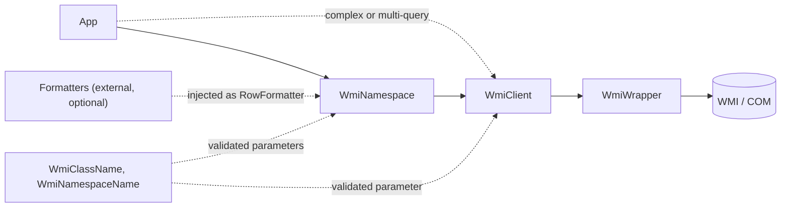

# wmi-query

C++23 library for querying Windows Management Instrumentation (WMI). Pick a WMI
class and the properties you need, run the query, and read the results back as
strings. For anything beyond "all instances of one class" (a WHERE clause,
`ASSOCIATORS OF`, dependent queries) run your own query text through
`WmiClient`. A separate, optional set of formatters for WMI dates and
byte/decimal sizes plugs in per property.

## Features

- Thin RAII wrapper over the WMI COM interfaces (`IWbemLocator`,
  `IWbemServices`, `IEnumWbemClassObject`).
- Two entry points. `WmiNamespace` is the simple one: one object per WMI class
  and property list, with the fixed query `SELECT * FROM <class>`, queried
  repeatedly. `WmiClient` is the general one: it runs any query text, so it is
  the way to use complex queries.
- Values are returned as `std::wstring` (or `int`), so callers never touch
  `VARIANT`.
- Failures are returned, not hidden: every operation that can fail returns
  `std::expected` with the `HRESULT` as the error, so "found nothing" and "the
  query failed" are different outcomes. A failed query never leaves the
  previous result behind.
- A `WmiClient` can only be obtained through `WmiClient::Create()`, which
  connects. A connection failure is reported once, by that call, so every
  client that exists was connected when it was created.
- Class and namespace names are validated types. An invalid name is a
  programmer error, so it throws `std::invalid_argument` when the name is
  constructed and can never reach a query.
- Formatting is optional. The core accepts any text-to-text callable per
  property. A ready-made companion set (`Formatters.hpp`) is included for
  `DD.MM.YYYY` dates, binary units and decimal (x1000) units.
- A failed `Connect()` is rolled back with an RAII guard, and a failed
  `Initialize()` leaves nothing initialized, so no half-built COM state is left
  behind.
- Clean under `clang-tidy` with warnings treated as errors.

## Requirements

- Windows 10 or later.
- A C++23 compiler (developed with MSVC and clang-tidy).
- Links against `wbemuuid.lib` (already requested via `#pragma comment`).
- `scope.hpp`: the RAII guards (`amitgdev::scope_exit` and friends) come from
  shared infrastructure code, not from this library. `WmiWrapper.cpp` needs it
  on the include path.

## Layout

| File | Role |
| --- | --- |
| `WmiWrapper` | COM and WMI adapter. The only class that touches COM, BSTR and VARIANT. Reports failures as a `Result` (an `int32_t` carrying an `HRESULT`) and rolls back partial setup. |
| `WmiClient` | Connected session and general query runner. Created with `WmiClient::Create()`; runs any number of queries, with any query text, over that one connection. Returns the error of a failed query. |
| `WmiNamespace` | Simple facade for one WMI class with the fixed query `SELECT * FROM <class>`. Holds the property list and formatters, caches the last result, and provides the static `GetValue()` lookup. |
| `ValidatedString` | Template for a `std::wstring` that is valid by construction. Each validation rule gives a distinct type. |
| `WmiClassName`, `WmiNamespaceName` | Validated types for the two names that reach WMI (see below). Literals convert implicitly. |
| `Formatters` (optional companion) | Standalone formatting functions (`FormatDate`, `FormatB`, `FormatKB`, `FormatMB`, `FormatDecimal`). No WMI dependency, and the core does not include them: include `Formatters.hpp` only where you use them. |



### Choosing WmiNamespace or WmiClient

| You need | Use |
| --- | --- |
| All instances of one class, chosen properties, optional formatting | `WmiNamespace` |
| A WHERE clause or any query other than `SELECT * FROM <class>` | `WmiClient` |
| Related objects (`ASSOCIATORS OF`, `REFERENCES OF`) | `WmiClient` |
| Several dependent queries over one connection | `WmiClient` |

`WmiNamespace` has no way to change its query. The price of `WmiClient` is that
the query text is yours: nothing validates it (see
[Complex queries](#complex-queries-and-multi-query-chains)).

## Quick start

Add the files in `src/` to your project, then:

```cpp
#include <cstdint>
#include <cstdlib>
#include <format>
#include <iostream>
#include <variant>

#include "WmiNamespace.hpp"
#include "WmiWrapper.hpp"
#include "scope.hpp"

int main() {
  // Once per thread, before any query. A failure leaves nothing to undo.
  if (amitgdev::WmiWrapper::Initialize() < 0) {
    return EXIT_FAILURE;
  }

  // Balances Initialize() on every exit path.
  const amitgdev::scope_exit cleanup_guard{
      [] noexcept { amitgdev::WmiWrapper::Uninitialize(); }};

  amitgdev::WmiNamespace time_zone(
      L"Win32_TimeZone", {L"Bias", L"DaylightName", L"Description"});

  // "Found nothing" (a count of 0) and "the query failed" are different
  // outcomes, so the failure is checked before the data is read.
  if (const auto count = time_zone.Query(); !count) {
    std::wcerr << std::format(L"Query failed: HRESULT {:#010x}\n",
                              static_cast<std::uint32_t>(count.error()));
    return EXIT_FAILURE;
  }

  // One column per returned WMI object.
  for (const auto& column : time_zone.Data()) {
    for (const auto& [name, value] : column) {
      if (const auto* text = std::get_if<std::wstring>(&value)) {
        std::wcout << name << L" : " << *text << L'\n';
      }
    }
  }
}  // time_zone is destroyed before the guard runs, so WMI objects are released
   // before COM is torn down.
```

`Query()` can be called again to refresh. `WmiNamespace` defaults to the
`ROOT\CIMV2` namespace. Pass the namespace as the first argument to use another
one:

```cpp
amitgdev::WmiNamespace defender(L"ROOT\\Microsoft\\Windows\\Defender",
                                L"MSFT_MpComputerStatus", {L"AMServiceEnabled"});
```

### Class and namespace names

The class name is placed into the WQL text of `WmiNamespace` and the namespace
name selects what `ConnectServer` reaches, so both are validated types instead
of plain strings. Validation happens once, in the constructor: an invalid value
throws `std::invalid_argument` and cannot exist, so no other code re-checks it.

| Type | Accepted | Refused |
| --- | --- | --- |
| `WmiClassName` | A letter, then letters, digits or underscore: `Win32_TimeZone` | Empty text, a leading digit or underscore (so system classes such as `__Namespace`), spaces, quotes, anything else |
| `WmiNamespaceName` | Names separated by single backslashes, each following the class-name rule: `ROOT\CIMV2` | Empty text, a leading, trailing or doubled backslash, remote forms such as `\\server\root` |

Wide string literals convert implicitly, so the examples above read as plain
text. A runtime `std::wstring` needs the explicit form:

```cpp
const std::wstring name = ReadClassNameFromConfig();
amitgdev::WmiNamespace by_name(amitgdev::WmiClassName{name}, {L"Description"});
```

The exception text states the rule but not the value, because the value is
arbitrary caller text. A bad literal fails at construction, before any COM call.

### Reading results

`Data()` returns every returned object: a list of columns, each a list of
`(property name, value)` pairs. The reference stays valid until the next
`Query()`, successful or not. After a failed `Query()` it is empty.

```cpp
amitgdev::WmiNamespace serial_ports(L"Win32_SerialPort",
                                    {L"Description", L"DeviceID"});
if (!serial_ports.Query()) {
  return;  // Data() is empty on failure.
}

for (const auto& column : serial_ports.Data()) {
  for (const auto& [name, value] : column) {
    if (const auto* text = std::get_if<std::wstring>(&value)) {
      std::wcout << name << L" : " << *text << L'\n';
    }
  }
}
```

To read one value, use the static `WmiNamespace::GetValue(column, row_title)`.
It works on any `Column`, including one returned by `WmiClient`, and reports a
missing property, or a cell that is not text, as an error instead of an empty
string:

```cpp
if (!serial_ports.Data().empty()) {
  if (const auto device_id = amitgdev::WmiNamespace::GetValue(
          serial_ports.Data().front(), L"DeviceID")) {
    std::wcout << *device_id << L'\n';
  }
}
```

### Formatting values

A formatter turns the text of one property into display text. Pass a list of
`RowFormatter`s as the last constructor argument. They run after every
successful `Query()`, in list order, on that property in every returned object.
The formatters below come from the optional companion set:

```cpp
#include "Formatters.hpp"

amitgdev::WmiNamespace os(
    L"Win32_OperatingSystem",
    {L"Caption", L"InstallDate", L"TotalVisibleMemorySize"},
    {
        {.row_title = L"InstallDate", .format = amitgdev::FormatDate},
        {.row_title = L"TotalVisibleMemorySize", .format = amitgdev::FormatKB},
    });
if (!os.Query()) {
  return;
}
// Data() already holds the formatted values.
```

| Formatter | Input | Output example |
| --- | --- | --- |
| `FormatDate` | WMI datetime (`YYYYMMDD...`) | `04.10.2026` |
| `FormatB`, `FormatKB`, `FormatMB` | Size in bytes, KB or MB (digits only) | `16G`, `512` (plain bytes have no suffix), `512K` |
| `FormatDecimal` | Value in mega units, such as a clock speed in MHz | `2400` -> `2.4G`, `800` -> `800M` |

Notes on the companion formatters:

- Sizes are scaled by integer division, so they are truncated, not rounded:
  `1536` bytes becomes `1K`. Units go up to peta (`P`); a value beyond that is
  returned unchanged.
- Input that a formatter cannot parse is returned unchanged. For the size
  formatters that means anything that is not a plain digit string. `FormatDate`
  only checks the length: input shorter than 8 characters is returned
  unchanged, anything longer is cut by position, so apply it only to WMI
  datetime properties.
- `Format1024` and `Format1000` are the common scalers behind the specialized
  formatters. Use them directly for another input unit.

Write your own formatter as any callable that takes the text and returns the
text. It knows nothing about WMI, so a free function, a lambda or a functor all
work. It takes the text by value or by `const&`, and may return the input
unchanged as a fallback:

```cpp
// Intent: keep the raw code when it is unknown, so no information is lost.
std::wstring FormFactorName(std::wstring code) noexcept {
  return code == L"8" ? L"DIMM" : code;
}

amitgdev::WmiNamespace memory(
    L"Win32_PhysicalMemory", {L"Capacity", L"FormFactor"},
    {
        {.row_title = L"Capacity", .format = amitgdev::FormatB},
        {.row_title = L"FormFactor", .format = FormFactorName},
    });
```

A formatter for a property that is not in the property list has no effect. A
cell that does not hold a string, or whose formatter throws, is skipped and
keeps its original value. `WmiClient` does not apply formatters: format the
returned `Columns` yourself.

## Error handling

- Every function that can fail returns `std::expected<T, Result>` (or a plain
  `Result`). `Result` is an `int32_t` carrying an `HRESULT`; a negative value is
  a failure. All of them are `[[nodiscard]]`.
- `Query()` on `WmiNamespace` returns the number of objects found, or the
  `HRESULT` of the failure (connection, WQL or provider error). `0` means
  nothing matched; it is never a failure in disguise.
- A failed `WmiNamespace::Query()` clears `Data()` first, so it is empty and
  never holds the previous result.
- WMI reports some query errors (a bad class, bad WQL, access denied) only while
  the result set is read. They are returned as errors, never treated as the end
  of the data, and no partial result is returned.
- A property the class does not define, or one of an unsupported type, maps to
  an empty string, so callers can probe optional properties. Any other failure
  while reading a property is an error.
- A connection can be lost after `WmiClient::Create()` succeeds (for example the
  WMI service restarts). The next `Query()` then returns a transport `HRESULT`
  such as `RPC_S_SERVER_UNAVAILABLE`. `WmiClient` does not reconnect: create a
  new client.

## Behavior notes

- **COM lifetime.** `WmiWrapper::Initialize()` and `Uninitialize()` are static.
  COM initialization is per thread, so every successful `Initialize()` must be
  balanced by one `Uninitialize()` on the same thread, calls can nest, and every
  thread that uses the library needs its own pair. Every `WmiNamespace` and
  `WmiClient` must be destroyed before the last `Uninitialize()`: releasing a
  COM interface after COM is uninitialized is undefined behavior. Without
  `Initialize()`, a query fails with `CO_E_NOTINITIALIZED`.
- **Repeated `Initialize()` is fine.** COM security can be set only once per
  process. If it was already set (by an earlier call or by the host
  application), that is accepted and the earlier setting stays; each connection
  sets its own proxy security, so queries still work.
- **Setup is atomic.** A failed `Initialize()` leaves nothing initialized, and a
  failed `Connect()` leaves the wrapper disconnected.
- **Invalid names throw.** A class or namespace name that breaks its rule throws
  `std::invalid_argument` at construction, before any query. Out of memory in
  `GetColumns`, `WmiClient::Query` or `WmiNamespace::Query` throws
  `std::bad_alloc`; every other failure is returned.
- **Supported property types.** Strings, integers (including unsigned 32-bit
  values and 8 and 16-bit integers) and booleans (printed as `0` or `1`). Real
  numbers, arrays, null and other types map to an empty string.
- **Single pass.** Each `Query()` fetches the full result set into memory, so
  repeated reads use the cached data. `WmiNamespace` connects again on every
  `Query()`; use one `WmiClient` when several queries should share a connection.
- **Copying and moving.** `WmiWrapper` and `WmiClient` own COM pointers, so they
  cannot be copied. They are move-constructible (that is how `Create()` returns
  a connected client); a moved-from object is disconnected. `WmiNamespace` is a
  plain `final` value type.
- **Thread safety.** No object is thread safe. Use one object per thread or
  serialize access.

## Extending

Another validated string is a few lines: write a rule with a static
`IsValid(std::wstring_view)` and a `kRequirement` text, then alias
`ValidatedString<YourRule>`. `WmiClassName` is the reference.

`WmiNamespace` is `final`, so it is not meant to be derived from. Read values
with `Data()` and the static `GetValue()`; a class that combines several
queries holds a `WmiClient` instead (next section).

## Complex queries and multi-query chains

Use `WmiClient` directly when you need more than `SELECT * FROM <class>`: a
WHERE clause, `ASSOCIATORS OF`, or several queries where one result feeds the
next. One client keeps one connection for the whole job, and `Query()` returns
the same `Columns` type as `WmiNamespace`, so `GetValue()` still applies.

```cpp
#include <cstddef>
#include <expected>

#include "WmiClient.hpp"
#include "WmiNamespace.hpp"

std::expected<std::size_t, amitgdev::Result> CountPartitions() {
  // One connection for every query. A connection failure is reported here,
  // once, and no client exists afterwards.
  auto client = amitgdev::WmiClient::Create();  // Defaults to ROOT\CIMV2.
  if (!client) {
    return std::unexpected(client.error());
  }

  // Query 1: the query text is yours. A WHERE clause works the same way:
  // L"SELECT * FROM Win32_LogicalDisk WHERE DriveType = 3".
  const auto drives = client->Query(L"SELECT * FROM Win32_DiskDrive",
                                    {L"DeviceId", L"Model"});
  if (!drives) {
    return std::unexpected(drives.error());
  }

  std::size_t partition_count = 0;
  for (const auto& drive : *drives) {
    const auto drive_id = amitgdev::WmiNamespace::GetValue(drive, L"DeviceId");
    if (!drive_id || drive_id->empty()) {
      continue;  // Nothing to look up without an id.
    }

    // Query 2: this drive's partitions. The device ID comes from WMI itself and
    // goes into the query text as received.
    const auto partitions = client->Query(
        L"ASSOCIATORS OF {Win32_DiskDrive.DeviceID='" + *drive_id +
            L"'} WHERE AssocClass=Win32_DiskDriveToDiskPartition",
        {L"DeviceId"});
    if (!partitions) {
      return std::unexpected(partitions.error());
    }

    partition_count += partitions->size();
  }

  return partition_count;
}
```

`MultiQueryDrives` in `main.cpp` is the complete version. A small `Drives`
class wraps three levels (drive, partitions, logical drives), keeps each
physical drive together with its logical drives, and exposes `Data()` and
`GetTotalSize()`. Its results are printed with the same `Print` used for single
queries, and the total is shown with `FormatB`.

Notes:

- **No query-text validation.** `WmiClient` validates the namespace name it
  connects to, but not the query text, unlike `WmiNamespace`, whose class name
  is a validated type. Only use developer-written text, or identifiers that WMI
  itself returned (as the sample does). Never put untrusted text into a query
  string.
- **A failed level is an error, not an empty result.** If a query fails,
  `Query()` returns the `HRESULT`, and the sample returns it, so a broken
  association is never mistaken for a drive without partitions. A query that
  simply finds nothing returns an empty `Columns`.
- **The property list filters after enumeration.** The second argument of
  `Query()` lists the properties to read from each returned object. It does not
  change what WMI computes, and a property the returned class does not define
  maps to an empty string.
- **Partitions without a drive letter do not appear.**
  `Win32_LogicalDiskToPartition` only links partitions that have a logical
  drive, so EFI and recovery partitions are missing from the third level.
- **Format on a copy if you format.** `WmiClient` returns plain `Columns`; apply
  your own formatting to them, for example with the companion formatters.

## Requirements

A C++23-compatible compiler and standard library.

## Build and Run

- [Build on Windows](https://github.com/AmitGDev/cpp-ci-template#build-on-windows)

## Code Style

- [C++](https://github.com/AmitGDev/cpp-coding-standard)
- [Python](https://github.com/AmitGDev/cpp-ci-template#python)
- [CMake](https://github.com/AmitGDev/cpp-ci-template#cmake)

## License

MIT License. Copyright © 2024-2026 Amit Gefen.

---

**Last Updated:** 2026-10-23  
**Maintainer:** AmitGDev
